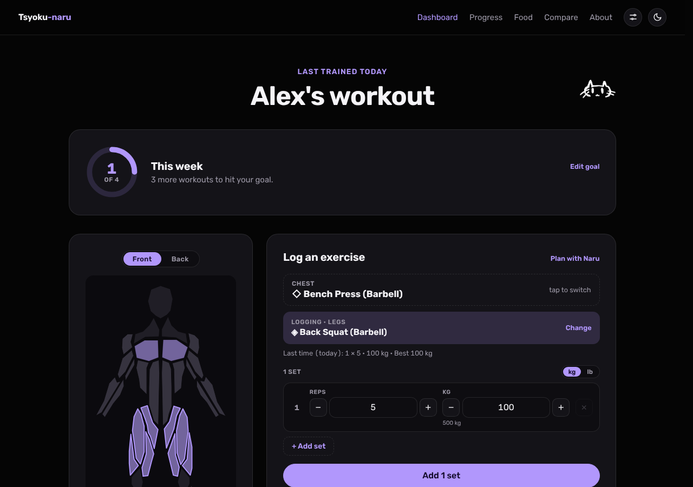
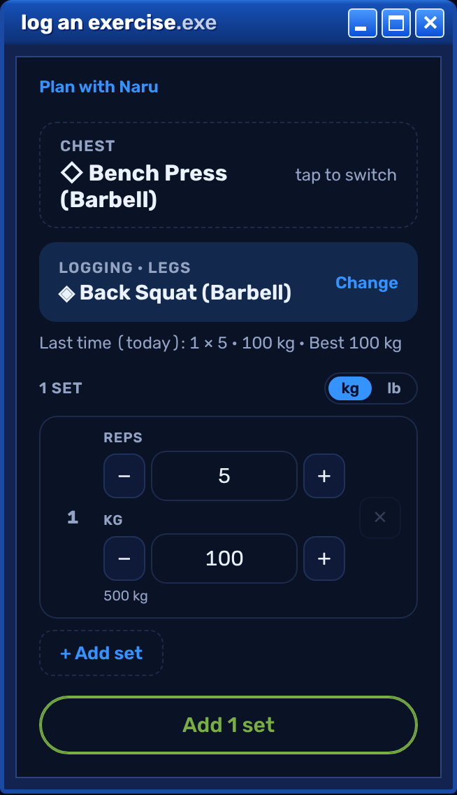
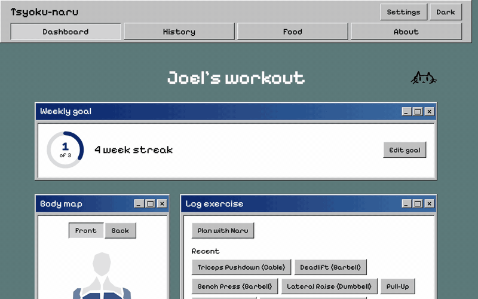
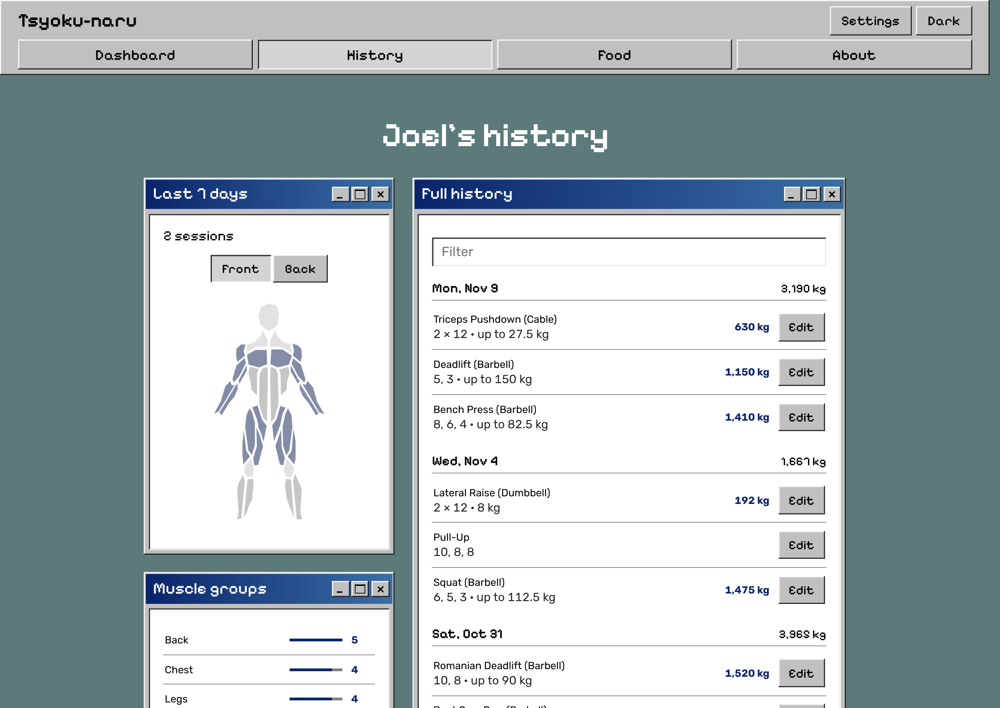

# 🏋️ Tsyoku-naru: Workout Tracker

[](https://github.com/byjoelsamuel/workout-tracker/actions/workflows/ci.yml)


**強くなる** (*tsuyoku naru*): "to become stronger."

Log every set, and a body map shows which muscles you've trained lately and
which you've been skipping. Free, private and no account: everything stays on
your device. One codebase runs as a website, an installable iPhone app, an
Android app and a desktop app for Windows and Fedora.

**[Open the app →](https://tsyoku-naru.netlify.app/)** ·
[Download](https://github.com/byjoelsamuel/workout-tracker/releases/latest) ·
[What's new](CHANGELOG.md)



## What you can do

- **Log by the set.** Pick from 157 movements and give each set its own reps
  and weight. A movement you've done before starts from last time.
- **Log two exercises at once.** Open a second panel for supersets and switch
  between them with a tap.
- **See what you've been skipping.** The body map (front and back) fades over a
  few weeks, so it shows what you've worked lately. Tap a muscle to train it.
- **Stay on track.** A weekly goal with a streak, a rest timer that starts
  itself, undo after every log, and a call-out when you beat a personal best.
- **Get a plan.** **Naru**, an optional planner, builds a full-body session
  from your own history, on your device.
- **Log food.** Scan a barcode (Android app) or search, pick the amount, and
  see the day's calories and macros. Packaged food comes from
  [Open Food Facts](https://world.openfoodfacts.org); about 50 common whole
  foods (rice, eggs, chicken) are built in.
- **Make it yours.** kg or lb, light or dark (switched with a pixel mosaic),
  keyboard-friendly, and it respects reduced-motion settings.

<p align="center">
  
  &nbsp;
  
</p>



## Get it

| Where | How |
|---|---|
| **Web** | [tsyoku-naru.netlify.app](https://tsyoku-naru.netlify.app/). Deploys from `main`. |
| **Android** | [`Tsyoku-naru.apk`](https://github.com/byjoelsamuel/workout-tracker/releases/latest/download/Tsyoku-naru.apk). Open it on your phone and allow installs from your browser when asked. |
| **iPhone / iPad** | Open the website in Safari, then **Share → Add to Home Screen**. Works offline. |
| **Windows 11** | [`Tsyoku-naru-Setup-x64.exe`](https://github.com/byjoelsamuel/workout-tracker/releases/latest/download/Tsyoku-naru-Setup-x64.exe). Not code-signed, so choose **More info → Run anyway** if SmartScreen asks. |
| **Fedora** | `sudo dnf install https://github.com/byjoelsamuel/workout-tracker/releases/latest/download/Tsyoku-naru-x86_64.rpm` |
| **Other Linux** | [`Tsyoku-naru-x86_64.AppImage`](https://github.com/byjoelsamuel/workout-tracker/releases/latest/download/Tsyoku-naru-x86_64.AppImage). `chmod +x` and run (needs `fuse-libs`). |

## Your data stays with you

There's no account and no server. Workouts and meals are saved on the device.
The only thing that goes out is a food search or barcode, to Open Food Facts.

- **Each install keeps its own history.** The website, the Android app, the
  desktop app and an iPhone Home Screen app don't share data. Move it with
  **Settings → Backup**: export on one, import on the other. Importing never
  overwrites anything.
- **Updates:** the website and iPhone app update themselves. The Android and
  desktop apps tell you when a new version is out, with a Download button;
  install it over the top and your history stays. **Settings → Help → Updates**
  checks on demand.

## Roadmap

| Phase | What | Status |
|---|---|---|
| **1 · Layout** | Two-exercise logger, a Food tab, a spot for the mascot | Done |
| **2 · Look** | Windows 98 style: beveled windows, pixel type, big plain labels, muted colours | Done |
| **3 · Apps & quality** | Android app, unit and browser tests, CI on every pull request | Done (1.4.0) |
| **4 · Food log** | Barcode scan and search, calories and macros per meal, a protein target from your bodyweight | First version (1.5.0) |

Details of every change are in the [changelog](CHANGELOG.md).

## For developers

```bash
npm install
npm run dev           # http://localhost:5173
npm run lint          # ESLint
npm test              # unit tests (Vitest)
npm run build         # production build into dist/
npm run test:e2e      # browser tests (Playwright) against the build
npm run desktop       # build, then open the Electron app
npm run dist:linux    # Fedora .rpm + AppImage into release/
npm run android:sync  # build, then copy it into the Android project
```

**Stack:** React 19, Vite, React Router and Motion. Data lives in
`localStorage`, offline support comes from a generated service worker, the
desktop app is Electron and the Android app is Capacitor. All of them run the
same build.

**Tests:** unit tests in `tests/` cover the logic in `src/lib/`: unit
conversion, personal bests, weekly streaks, the body map's fade, Naru's
planner, and the store, including loading every older shape of saved data and
backup import and export. The browser test in `e2e/` creates a profile, logs a
set, ends the workout, finds it in History and switches the theme, at desktop
and phone sizes. [CI](.github/workflows/ci.yml) runs lint, both test suites and
the build on every pull request.

The modules in `src/lib/` explain in their comments the rules that keep old
data meaning the same thing. The storage keys in particular are a fixed format,
so don't rename them.

### Releasing

Bump `version` in `package.json` and merge to `main`. GitHub Actions builds the
Windows installer, the Linux packages and the Android APK, and publishes the
`v<version>` release. Merges that don't change the version only redeploy the
website.

### Android signing

Release APKs are signed with a key kept in the repo's Actions secrets, never in
the repo. To set it up once:

```bash
keytool -genkeypair -v -keystore tsyoku-naru.jks -alias tsyoku-naru \
  -keyalg RSA -keysize 4096 -validity 10000
base64 -w0 tsyoku-naru.jks > tsyoku-naru.jks.b64
```

Then add four secrets under **Settings → Secrets and variables → Actions**:
`ANDROID_KEYSTORE_BASE64` (the contents of the `.b64` file),
`ANDROID_KEYSTORE_PASSWORD`, `ANDROID_KEY_ALIAS` (`tsyoku-naru`) and
`ANDROID_KEY_PASSWORD`. Keep the `.jks` file and passwords somewhere safe:
every future update has to be signed with the same key. Without the secrets,
CI still builds a debug APK to prove the project compiles, but nothing is
attached to the release. To add the APK to a release that went out without
it, run the **Apps** workflow by hand from the Actions tab with **publish**
ticked.

## Credits & license

Body map geometry from [react-body-highlighter](https://github.com/giavinh79/react-body-highlighter)
(MIT). Food data from [Open Food Facts](https://world.openfoodfacts.org)
(ODbL). Typefaces [Pixelify Sans](https://github.com/eifetx/Pixelify-Sans) and
[Rubik](https://github.com/googlefonts/rubik) (OFL). See
[`THIRD-PARTY.md`](THIRD-PARTY.md). Released under the MIT License; see
[`LICENSE`](LICENSE).

Built by [Joel Samuel](https://github.com/byjoelsamuel)
